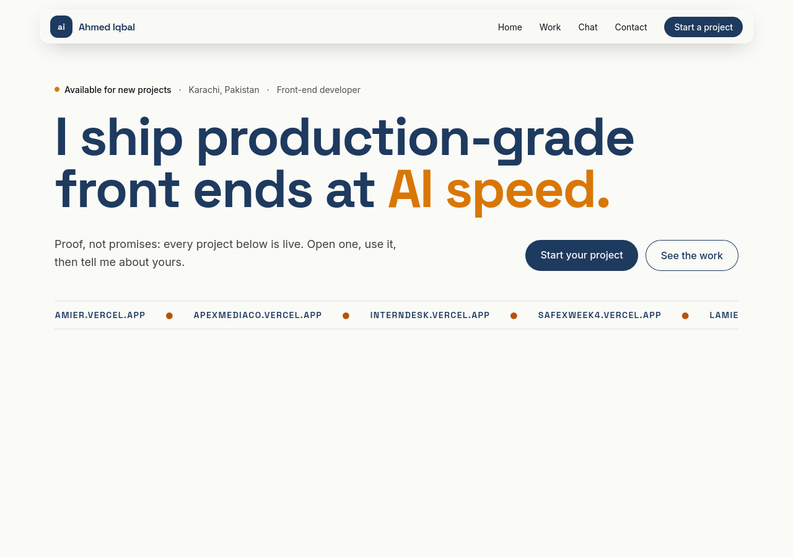
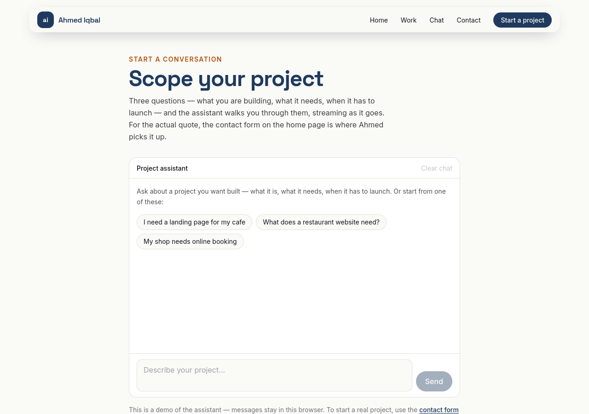
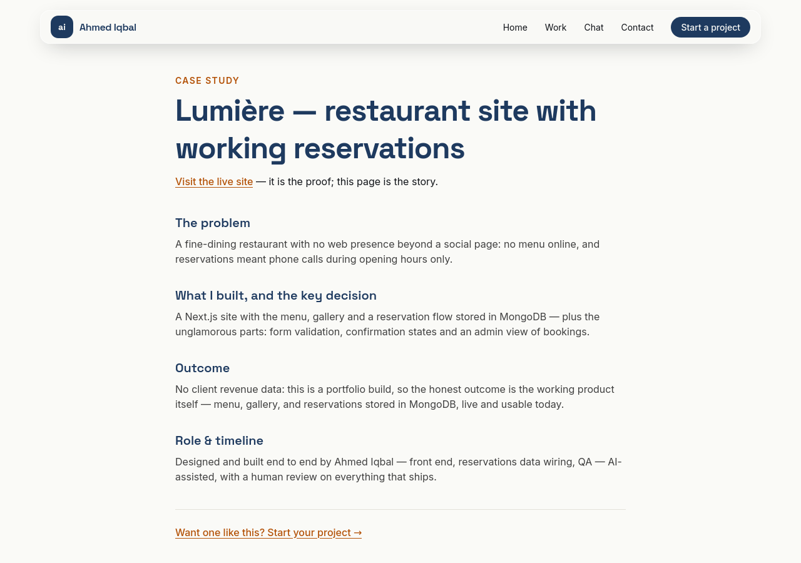

# flyrank-frontend

Ahmed Iqbal's FlyRank capstone: a portfolio that proves the through-line
**"I ship production-grade front ends at AI speed."** Next.js 15 + React 19 +
Tailwind v4, deployed on Vercel from this repo's `main` branch.

**Production: https://ahmediqbal.vercel.app** (a second deployment of the
same repo lives at https://flyrank-frontend-five.vercel.app).

## What it is

A portfolio for startup founders and hiring managers, with one action:
contact Ahmed about their next build. Every project below is live — open
one, use it, then judge the work by the working product, not the pitch.



## Routes

| Route | What it is |
|---|---|
| `/` | Home: claim, live-proof marquee, featured work, about, contact |
| `/work/[slug]` | Case studies (Lumière, ApexMediaCo) |
| `/chat` | The streaming project-qualification chat (FE-06/07/08) |
| `/cv` | CV page (with a print-to-PDF download button) |
| `/buttons` | SmartButton demo page (FE-AA1) |
| `/3d` | Interactive 3D configurator (FE-AA2, deliberately unlinked from nav) |
| `/health` | Fetches this repo's data from the GitHub API server-side (ISR, 1h) |
| `/api/chat` | The chat route handler (streaming, tools, failure drills) |
| `/api/contact` | The contact-form backend (writes to Supabase) |



## Run it yourself

```bash
git clone https://github.com/axediqbal/flyrank-frontend.git
cd flyrank-frontend
npm install
npm run dev        # http://localhost:3000
```

Production build, exactly what CI runs:

```bash
npm run build
npm start
```

Tests:

```bash
npm run test       # Vitest + React Testing Library (15 tests)
npm run test:e2e   # Playwright, one primary-flow test (needs a build first)
```

No API keys are needed to run it: with no keys set, the chat runs in
its honestly-badged demo mode and the contact form reports itself as
unconfigured instead of failing silently.

## Environment

| Variable | Required | What it does |
|---|---|---|
| `SUPABASE_URL` | Yes, for the contact form | Supabase project URL (table: `contact_messages`) |
| `SUPABASE_ANON_KEY` | Yes, for the contact form | Anon key — insert-only RLS, so it can add a row and never read, change or delete one |
| `GEMINI_API_KEY` | No | Server-side only; unset = demo mode (badged in the UI) |
| `NEXT_PUBLIC_SITE_URL` | Yes, for metadata | Canonical site URL, used for Open Graph tags and canonicals |

Set them in Vercel (Project → Settings → Environment Variables) for
`production` and `preview`, or in a local `.env.local` (never committed
— `.gitignore` covers it; the repo ships only a `.env.example` template).

## Architecture

```
src/
  app/            App Router pages + route handlers
    api/chat/     streaming chat (NDJSON events, score_lead tool)
    api/contact/  contact form backend (validation, dedup, Supabase insert)
  components/     Chat, ContactForm, SmartButton, Nav, StudioScene, …
  lib/            chat-config, score-lead, contact, rate-limit
```

Data flow, contact: browser → `POST /api/contact` → validation →
honeypot + dedup + rate-limit guards → Supabase `contact_messages` row,
which Ahmed reads in the Supabase dashboard. No server of his own, no
mail server — free tier throughout (Vercel hobby + Supabase free).

Data flow, chat: browser → `POST /api/chat` → NDJSON event stream. Live
mode calls Gemini when `GEMINI_API_KEY` is set; otherwise a scripted
demo flow walks the same qualification steps and the UI badges it as a
demo. One event protocol serves both modes (see the tool contract
below).



## The chat

One NDJSON event protocol serves both modes — live (Gemini, when
`GEMINI_API_KEY` is set server-side) and demo (a scripted qualification
flow, honestly badged in the UI). Prompt and model config live in
`src/lib/chat-config.ts`; the route is `src/app/api/chat/route.ts`; the
client is `src/components/Chat.tsx`.

### Tool contract — `score_lead` (FE-07)

Defined in `src/lib/score-lead.ts` (that file is the deliverable).

- **Name:** `score_lead`
- **Purpose:** score how strong a sales lead is for a website build, from
  the few facts a visitor can state in one message.
- **Input schema (Zod):**

  | Field | Type | Notes |
  |---|---|---|
  | `business` | string, min 1 | Required — a lead cannot be scored without a name |
  | `type` | enum: cafe, restaurant, gym, clinic, salon, retail, other | Closest fit |
  | `rating` | number 0–5, optional | Omitted when unknown — never estimated; renders as "not provided" |
  | `reviews` | integer ≥ 0, optional | Same rule as rating |
  | `hasWebsite` | boolean | A working website of their own |
  | `runningAds` | boolean | Currently paying for social/search ads |
  | `contactPaths` | array of phone/whatsapp/instagram/form, default [] | How customers reach them today |

- **Return shape:** `{ score: 0–100, verdict: 'Strong fit' | 'Worth a
  conversation' | 'Weak fit', breakdown: [{ label, points, max, note }],
  recommendation: string }`. Deterministic — the same input always
  scores the same.
- **Invocation:** the route orchestrates the call — the client's intent
  (the /chat tool-demo buttons, behind `?demo=1`) or a "score … lead"
  phrasing. The four lifecycle states stream as typed parts
  (`input-streaming`, `input-available`, `output-available`,
  `output-error`) and each renders distinctly in the UI; the result
  renders as a score-card component, and a schema failure renders as a
  designed error card — never a crash, never a JSON dump.
- **Errors:** input failing the schema returns the Zod issues as the
  `output-error` part (e.g. `business: A business name is required to
  score a lead.`).

## Failure & empty states (FE-08)

The full inventory — every failure/edge case of the primary flow, how it
is triggered, and how it is handled — lives in [STATES.md](STATES.md),
including the sabotage checklist and its results. The /chat empty state
hosts live demos of the tool's success and error paths and of two failure
states (dropped stream, rate limit), each with a working retry. The demo
controls live behind `/chat?demo=1`; the public page shows a clean chat.

## Production notes (FE-11)

- **Rate limiting:** `POST /api/contact` allows 5 submissions per IP per
  10 minutes; `POST /api/chat` allows 30 per IP per minute. Every POST
  counts, successes and failures alike. Past the cap the API answers
  429 with a plain message — a status, not a crash.
- **Input caps:** contact fields are capped (name 100, email 200,
  message 2000 chars) and over-cap input is rejected with 422, never
  silently trimmed. Chat messages are capped at 50 per request and 4000
  characters each (400 beyond that).
- **Function timeouts:** `maxDuration` is declared on both handlers —
  10s for the contact insert (a single quick write), 30s for the
  streamed chat. A runaway stream cannot hang a function indefinitely.
- **Honest limit, stated openly:** the rate limit and the Week 7 dedup
  guard both live in the serverless instance's memory, so they are per
  instance, not global. They stop trivial abuse (one script hammering
  one instance); they are not a distributed firewall. A cross-instance
  limiter would need shared state (e.g. Upstash/Redis) — deliberately
  not added on a free tier. If a paid LLM key is ever set, add a shared
  limiter before opening live mode — per-instance limits will not bound
  LLM spend.
- **Double-submit guard:** identical contact submissions (same email +
  message) inside 60s return the original success with a duplicate flag
  and insert nothing — but only when routed to the same instance (see
  the limit above). A cross-instance guard would need a DB read, which
  the insert-only anon key cannot perform.
- **Git history:** no secrets are committed (only a `.env.example`
  template); `.gitignore` covers local env files. Commit messages
  describe the change, not the ticket.
- **Cross-browser:** verified in Chromium/Firefox on desktop (see the
  screenshots above, captured headlessly from the live site). Safari
  and mobile Safari are not verified from this environment — the
  manual check list at the end of this README covers them.

## Testing (FE-09, extended FE-11)

- `npm run test` — Vitest + React Testing Library, 15 tests: the chat
  across pending / streaming / error-with-retry and the score_lead tool
  lifecycle, the ScoreCard tool-result component, the validated contact
  form (empty-submit errors, a successful send, a failed send that keeps
  the visitor's text), the contact route's idempotency + rate limit, and
  the chat route's input caps + rate limit. Queries are by role and
  label throughout; the AI route is mocked with in-memory NDJSON streams
  in the component tests — the suite never calls the real API.
- `npm run test:e2e` — one Playwright test walks the primary flow:
  home -> chat -> the sample lead's ScoreCard -> a streamed reply. It
  runs in demo mode (`/chat?demo=1`), because the demo controls live
  behind that flag — running it on plain /chat was the CI failure this
  production pass fixed.
- CI (`.github/workflows/ci.yml`) runs both suites on every push and
  must be green before merging; branch protection requires it on
  `main`.

## FE-AA2 — 3D experience (`/3d`)

**What was built:** a procedural "studio product shot" rendered live in
the browser — a torus-knot sculpture with two amber accent spheres on
a shadow-catching floor, lit by a small lighting rig. No external
models, no external HDRs: the geometry and every light are defined in
code (`src/components/StudioScene.tsx`). The interaction beyond
orbiting is a custom configurator (`src/components/ThreeExperience.tsx`):
material colour swatches (Ink, Amber, Porcelain, Coal), metalness and
roughness sliders, a wireframe toggle, an auto-rotate toggle, and three
lighting presets (Studio / Daylight / Dusk). Orbit + pinch zoom come
from three's OrbitControls wrapped in a small R3F component — no drei,
no leva, by design. The page is deliberately unlinked from the nav: it
is an assignment deliverable, not part of the portfolio's
client-facing flow.

**Perf note (FE-10 lens):** `/3d` First Load JS is **106 kB** — the
route itself adds only 2.83 kB over the 103 kB shared baseline, because
the canvas loads via `next/dynamic` with `ssr:false`: three.js +
React Three Fiber ship in separate async chunks fetched only when
`/3d` opens (about 740 kB uncompressed on disk, about 189 kB gzipped
combined). What kept it sane: zero model/HDR downloads, one
shadow-casting light at 1024 px, small procedural geometry (torus knot
plus two spheres), device pixel ratio capped at `[1, 2]`, and a
fixed-height canvas container so the page never shifts while the scene
loads. Reduced-motion fallback: with `prefers-reduced-motion` the
canvas runs `frameloop="demand"` — a single static frame — while the
configurator still updates the material and lighting (config changes
invalidate explicitly). Frame rate was not lab-measured for this
deliverable; the geometry and light budget above is what bounds it.

**What I'd add with more time:** a drag-and-drop GLB viewer on top of
this staged scene (the brief's example direction), so visitors can
inspect their own models with the same configurator.

## Decisions worth knowing

- **Free tier throughout.** Vercel hobby + Supabase free + no paid
  services. Every guard in this repo is shaped by that: in-memory
  instead of Redis, insert-only keys instead of a backend server.
- **Demo mode is honest, not a fallback excuse.** When no Gemini key
  is set, the chat says it is a demo in the UI itself. A visitor is
  never led to believe they talked to a live model.
- **Validation runs twice.** Client-side checks are a courtesy; the
  route handler re-validates everything and is the only gate.
- **No lock-in to a component library.** The accessible components
  (Week 4 playground) and the 3D scene are hand-built; the only UI
  dependencies are React, Next.js and Tailwind.
- **One repo for the whole track.** Every FlyRank week builds on this
  codebase instead of starting fresh — the capstone is the portfolio,
  not a separate demo.

## How AI tools built this

Built with AI assistance (Claude AI) at AI-assisted speed, with a human
review on everything that ships: every change is read, tested (15 unit
tests + 1 e2e + a production build) and verified live before it is
claimed done. AI wrote first drafts of components, route handlers and
tests; the human decided the architecture, the copy, the limits (rate
limits, caps, timeouts) and what "done" means. Nothing in this repo was
submitted on the AI's word alone — the break log, the audit and the
test reports are the receipts.

## Manual check list (for a reviewer, or Ahmed on his phone)

- [ ] Home loads at https://ahmediqbal.vercel.app — headline, marquee,
  featured work, contact form all visible.
- [ ] Contact form: empty submit shows field errors; a real message
  sends and appears in the Supabase dashboard; a double-submit sends
  once; a 6th rapid submit answers 429.
- [ ] /chat streams a reply in demo mode; `/chat?demo=1` shows the
  tool demo and the failure drills, each with a working retry.
- [ ] /3d: drag orbits, pinch zooms, colour/metalness/wireframe/
  rotate controls respond, lighting presets change the scene.
- [ ] Safari + mobile Safari: home, /chat and one case page render
  correctly (not verified from the build environment — needs a real
  Apple device).

## Other apps in this repo

- `react-ai-app/` — the Week 3 React + AI build (Outreach Tracker).
- `playground/` — the Week 4 hand-built accessible components
  (modal, tabs, disclosure) with a shadcn comparison in its NOTES.md.
- `workflow/` — the FL-04 outreach opener pipeline: project instructions
  and the five documented runs.
